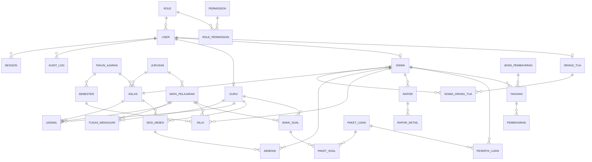

# ERD SIMS SMK YP 79 Majalaya

Database: PostgreSQL (Neon). Satu database terpusat untuk seluruh modul.
Skema lengkap ada di `prisma/schema.prisma`; ringkasan relasi utama di bawah.

## Gambaran Umum

## Kelompok Tabel

### 1. Autentikasi & RBAC
`users`, `roles`, `permissions`, `role_permissions`, `sessions`, `login_attempts`, `audit_logs`

### 2. Master Data
`pengaturan` (key-value), `tahun_ajaran`, `semester`, `jurusan`, `kelas`, `mata_pelajaran`,
`guru`, `siswa`, `orang_tua`, `siswa_orang_tua`, `kelas_diampu`

### 3. Kurikulum
`capaian_pembelajaran` (CP/TP/ATP), `tugas_mengajar`, `jadwal`, `kalender_akademik`,
`kktp`, `bobot_penilaian`

### 4. Absensi QR Code
`sesi_absen` (token QR di-hash, berlaku 15 menit, terikat jadwal+kelas),
`absensi` (unique `sesiId+siswaId` → cegah scan ganda), `pengajuan_izin`, `koreksi_absensi`

### 5. Penilaian & Rapor
`jenis_penilaian`, `nilai`, `rapor`, `rapor_detail`

### 6. CBT
`bank_soal`, `paket_ujian`, `paket_soal`, `peserta_ujian`, `jawaban`, `hasil_ujian`

### 7. Tata Usaha
`surat` (masuk/keluar), `arsip_dokumen`, `mutasi_siswa`, `kartu_pelajar`, `alumni`,
`ppdb_pendaftaran`, `ppdb_dokumen`

### 8. Keuangan
`jenis_pembayaran`, `diskon`, `tagihan`, `pembayaran`, `pengeluaran`

### 9. Website Publik
`berita`, `galeri`, `pengumuman`, `pesan_kontak`

### 10. Notifikasi & LMS Ringan
`notifikasi`, `materi`, `tugas`, `tugas_pengumpulan`

## Aturan Integritas

- Seluruh `id` menggunakan `cuid()` (string, tidak dapat ditebak).
- Foreign key dengan `onDelete: Cascade` pada data anak milik induk; `SetNull` pada relasi opsional.
- Unique constraint penting: `absensi(sesiId, siswaId)`, `nilai` diindeks per siswa+semester,
  `siswa.nis`, `siswa.qrCode`, `users.username`, `tagihan.kode`.
- Operasi yang mengubah saldo/status (pembayaran, persetujuan rapor, submit CBT) dijalankan
  dalam transaksi Prisma (`prisma.$transaction`).
- Semua aksi yang mengubah data dicatat ke `audit_logs`.
